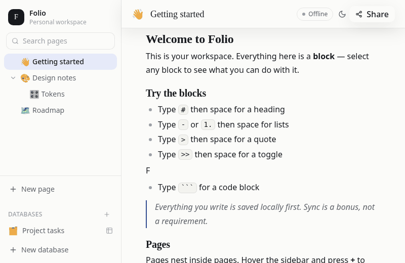
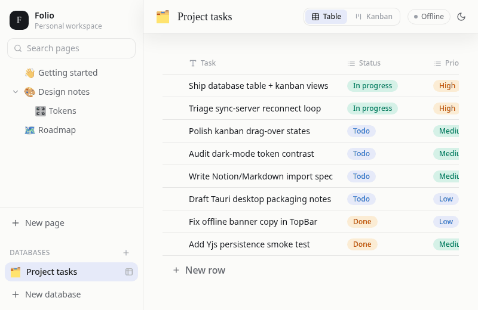
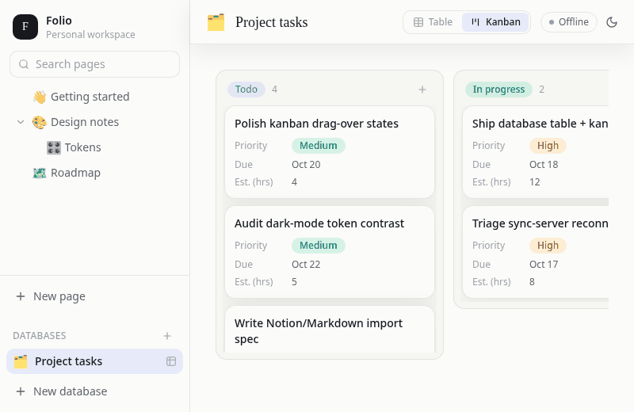
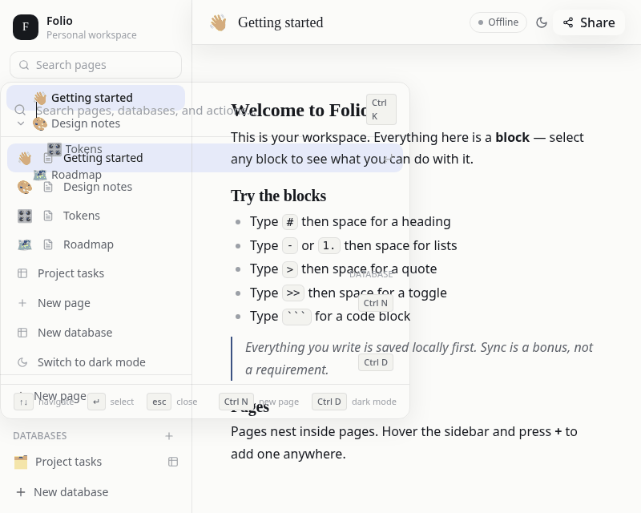
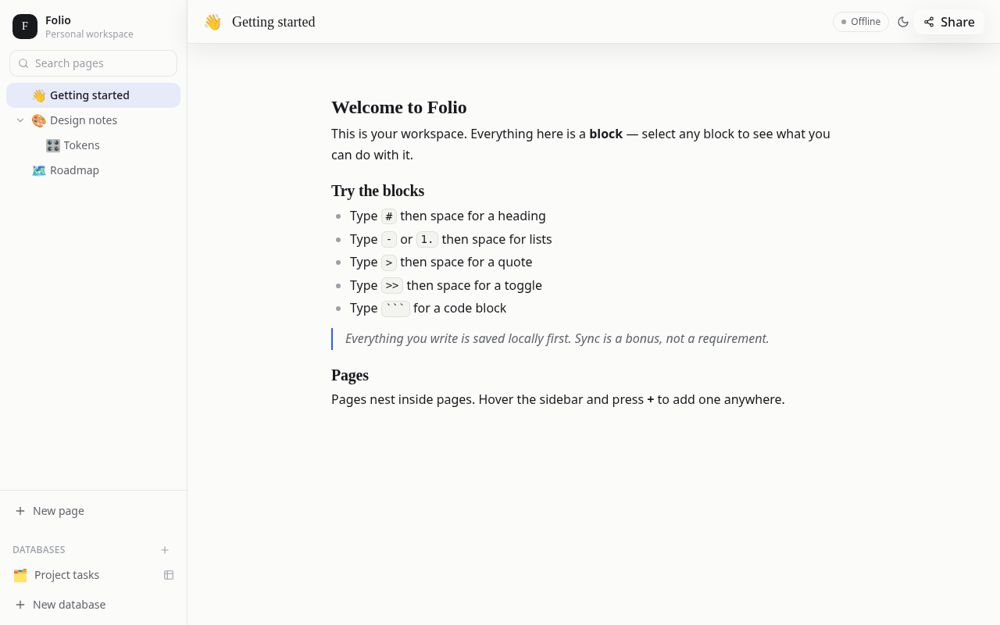
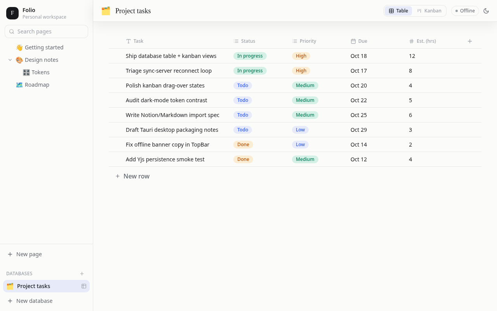
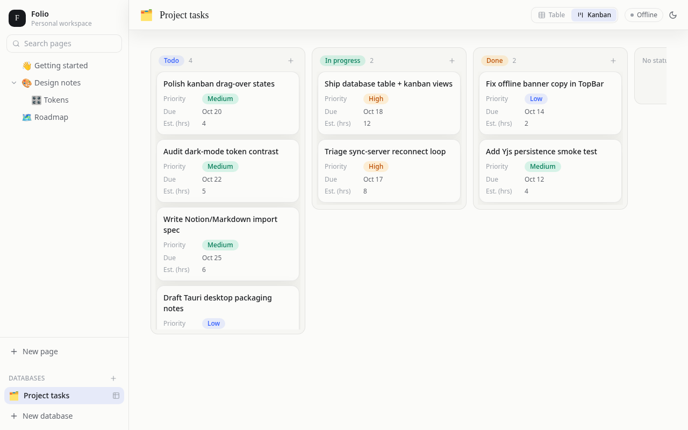
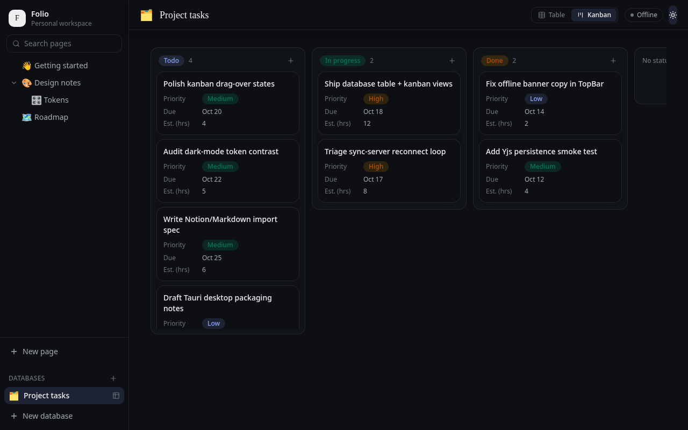

# Folio

### A free, open-source alternative to Notion.

[](LICENSE)
[](package.json)
[](CONTRIBUTING.md)
[](apps/web)
[](packages/editor)
[](packages/sync)

Folio is a Notion-style workspace you own outright. A fast **block editor**, nested pages,
**database** table and kanban views, a `Ctrl+K` **command palette**, and **realtime
collaboration** — free forever, MIT licensed, no account, no subscription. Everything you
write is saved locally first; sync is a bonus, not a requirement.

---

## ✨ See it in action

| Block editor                                              | Database table                                         |
| --------------------------------------------------------- | ------------------------------------------------------ |
|  |  |
| _Type anywhere — markdown shortcuts just work._           | _Sortable columns, inline cell editing._               |

| Kanban board                                                       | Command palette                                                         |
| ------------------------------------------------------------------ | ----------------------------------------------------------------------- |
|  |  |
| _Drag cards between status columns._                               | _`Ctrl/⌘+K` to search pages, or jump straight to dark mode._            |

## 📸 Screenshots

<p float="left">
  
  
</p>
<p float="left">
  
  
</p>

---

## 🚀 Features

- 📝 **Block-based editor** — every paragraph, heading, list, quote, toggle, and code
  block is its own block. Markdown shortcuts (`#`, `-`, `1.`, `>`, `>>`, ` ``` `) included.
- 🗂️ **Nested pages** — pages inside pages, with a fast sidebar tree and page search.
- 🗃️ **Databases** — table view with sortable headers and inline editing, plus a kanban
  board with drag-and-drop. Property types: text, number, date, select, checkbox.
- ⌨️ **Command palette** — `Ctrl/⌘+K` searches pages and databases and runs actions
  (new page, new database, toggle dark mode).
- 🌙 **Dark mode** — one keypress (`Ctrl/⌘+D`), or straight from the palette.
- 🤝 **Realtime collaboration** — Yjs CRDT documents over websockets, with live cursors
  and presence. Works fully offline; syncs whenever a server is reachable.
- 🖥️ **Desktop app** — Tauri scaffold ships alongside the web app.

## 🛠️ Tech stack

| Layer         | Technology                                                          |
| ------------- | ------------------------------------------------------------------- |
| Block editor  | [TipTap 2](https://tiptap.dev) (ProseMirror) with custom extensions |
| Realtime sync | [Yjs](https://yjs.dev) CRDTs + `y-websocket`                        |
| Web app       | React 19, TypeScript, Tailwind CSS v4, Vite                         |
| Desktop       | [Tauri](https://tauri.app)                                          |
| Sync server   | Node.js (`server/`)                                                 |
| Monorepo      | npm workspaces — `apps/*`, `packages/*`                             |

## ⚡ Quickstart

```bash
git clone https://github.com/Rustys90/folio.git
cd folio
npm install

npm run dev           # web app → http://localhost:5173
npm run dev:server    # optional realtime sync server
npm run dev:desktop   # Tauri desktop app
```

Other useful commands: `npm run build`, `npm run typecheck`, `npm run lint`.

## 🗺️ Project structure

```
folio/
├── apps/
│   ├── web/          # the writing workspace (React + Vite)
│   └── desktop/      # Tauri desktop shell
├── packages/
│   ├── editor/       # TipTap block editor (<FolioEditor>)
│   ├── sync/         # Yjs document setup + websocket provider
│   └── ui/           # design-system primitives (buttons, modals, menus)
├── server/           # realtime sync server
└── docs/demo/        # GIFs and screenshots used in this README
```

## 🤝 Contributing

Folio is early and we'd love your help. Bug reports, feature ideas, and pull requests are
all welcome — start with [CONTRIBUTING.md](CONTRIBUTING.md) and the
[code of conduct](CODE_OF_CONDUCT.md).

## 🔮 Roadmap

- [x] Database **calendar view**
- [x] Database **gallery view**
- [x] Page and database **templates**
- [x] **Import** from Markdown, CSV, and HTML
- [x] Block-level **comments** with threads, replies, and resolve
- [x] Page **version history** with auto-snapshots, manual saves, preview, and one-click restore
- [x] **File uploads** — per-page attachments with drag-and-drop, image previews, and image blocks in the editor
- [x] **Public page sharing** — publish pages to the web with unguessable links (`#/p/<id>`), read-only view
- [ ] **Mobile** apps
- [ ] **AI-assisted** writing features

Have a use case that isn't covered? [Open an issue](https://github.com/Rustys90/folio/issues)
and tell us about it.

## 📄 License

MIT — see [LICENSE](LICENSE). Build on it, fork it, ship it.
